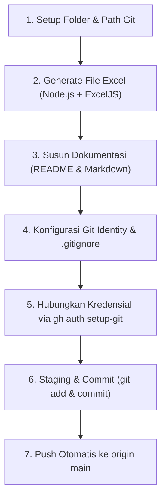

# Dokumentasi Hasil Riset & Langkah-Langkah Push Otomatis ke GitHub

Dokumen ini berisi rangkuman lengkap mengenai **hasil riset ide bisnis**, **struktur berkas Excel**, serta **panduan langkah demi langkah proses push otomatis** ke repositori GitHub [lusiaauliad/latihan](https://github.com/lusiaauliad/latihan).

---

## 📌 BAGIAN 1: HASIL AKHIR RISET

### 1.1 Tautan Repositori & File
* **Repositori GitHub:** [https://github.com/lusiaauliad/latihan](https://github.com/lusiaauliad/latihan)
* **Akun Pemilik:** `lusiaauliad` (Nama: `lusiaaulia`)
* **Branch Utama:** `main`
* **File Excel Utama:** [`Riset_Ide_Bisnis_Deduplikasi_Cloud_Storage.xlsx`](Riset_Ide_Bisnis_Deduplikasi_Cloud_Storage.xlsx)

### 1.2 Ringkasan Ide Bisnis: "Smart DedupliCloud"
* **Latar Belakang Masalah:** Rata-rata 30% - 50% kapasitas penyimpanan cloud pengguna (Google Drive, iCloud, OneDrive, Dropbox) terbuang sia-sia karena pengunggahan berulang file yang sama (foto, video ekspor, revisi dokumen kerja, attachment email).
* **Solusi yang Ditawarkan:** Layanan SaaS multi-platform (Desktop Agent, Chrome Extension, dan Web Dashboard) yang mendeteksi dan mencegah file duplikat sebelum upload dengan algoritma cryptographic hash (SHA-256) serta perceptual hash (pHash) untuk media visual.
* **Potensi Penghematan:** Pengguna dapat menghemat 67% - 89% biaya langganan bulanan tanpa perlu upgrade kapasitas storage, memangkas penggunaan bandwidth upload hingga 70%, dan menghemat waktu pencarian file hingga 4.2 jam/bulan.

### 1.3 Struktur Lembar Kerja Excel (5 Sheet Lengkap)
1. **Sheet 1 (`Kesimpulan Riset`):** Matriks sintesis masalah-solusi dari 30 sumber riset & tabel metrik angka kuantitatif.
2. **Sheet 2 (`Ringkasan Ide Bisnis`):** Konsep produk, target pasar B2C/B2B, strategi monetisasi, dan analisis SWOT.
3. **Sheet 3 (`30 Sumber Riset`):** Database 30 referensi akademik USENIX/IEEE, laporan Gartner/IDC/Flexera, whitepaper vendor cloud (Dropbox/Microsoft/Google), dan FinOps.
4. **Sheet 4 (`Validasi Pasar & Statistik`):** Analisis komposisi file duplikat (foto 42%, dokumen 28%, installer 18%, render media 12%) serta tabel perbandingan biaya.
5. **Sheet 5 (`Roadmap Produk & MVP`):** Rencana pengembangan 5 fase dari PoC, MVP Launch, Pre-Upload Interception, hingga Enterprise Edition.

---

## 🛠️ BAGIAN 2: LANGKAH-LANGKAH TEKNIS PUSH KE REPO GITHUB

Berikut adalah tahapan urut yang dijalankan untuk menginisialisasi, membuat berkas, hingga melakukan push ke GitHub:



### Langkah 1: Mempersiapkan Folder Kerja & Environment Git
Mengarahkan direktori ke folder repositori lokal dan memastikan path Git terdaftar pada terminal:
```powershell
Set-Location "C:\Users\puteh\.gemini\antigravity\scratch\latihan"
$env:PATH += ";C:\Program Files\Git\cmd;C:\Program Files\Git\bin"
```

### Langkah 2: Menginstal Pustaka & Membuat File Excel Otomatis
1. Menginstal library `exceljs` untuk pembuatan Excel berformat profesional:
   ```powershell
   npm install exceljs
   ```
2. Menjalankan skrip otomatisasi `generate_excel.js`:
   ```powershell
   node generate_excel.js
   ```
   *Skrip ini secara otomatis merender seluruh tabel, border, formula, dan palet warna ke berkas `Riset_Ide_Bisnis_Deduplikasi_Cloud_Storage.xlsx`.*

### Langkah 3: Mengatur File `.gitignore`
Menambahkan file `.gitignore` agar folder `node_modules` tidak terunggah ke repositori GitHub:
```text
node_modules/
package-lock.json
```

### Langkah 4: Mengonfigurasi Identitas Git
Mengatur identitas komit lokal:
```powershell
git config user.name "lusiaaulia"
git config user.email "lusiaauliad@users.noreply.github.com"
```

### Langkah 5: Otentikasi Kredensial GitHub
Mengintegrasikan GitHub CLI (`gh`) dengan Git agar proses push berjalan otomatis tanpa kendala pop-up password:
```powershell
gh auth setup-git
```

### Langkah 6: Staging & Menyimpan Commit
Mendaftarkan seluruh perubahan dan membuat commit terstruktur:
```powershell
git add .
git commit -m "feat: tambahkan riset ide bisnis deduplikasi cloud storage dalam format excel dari 30 sumber"
```

### Langkah 7: Melakukan Push ke Repositori Remote GitHub
Mengunggah branch `main` langsung ke repositori GitHub:
```powershell
git push origin main
```

---

## ⚡ BAGIAN 3: SKRIP OTOMASI PUSH SEKALI KLIK (`auto_push.bat`)

Untuk mempermudah pembaruan di masa mendatang, telah disediakan file skrip otomasi **`auto_push.bat`** di direktori proyek ini.

### Cara Menggunakan Skrip Otomatis:
Cukup klik ganda (*double click*) file **`auto_push.bat`** di File Explorer, atau jalankan melalui terminal:
```cmd
.\auto_push.bat
```
Skrip ini akan secara otomatis:
1. Mendeteksi seluruh perubahan berkas.
2. Melakukan staging (`git add .`).
3. Membuat komit dengan stempel waktu terkini (`git commit`).
4. Mengunggah seluruh perubahan langsung ke GitHub (`git push origin main`).
